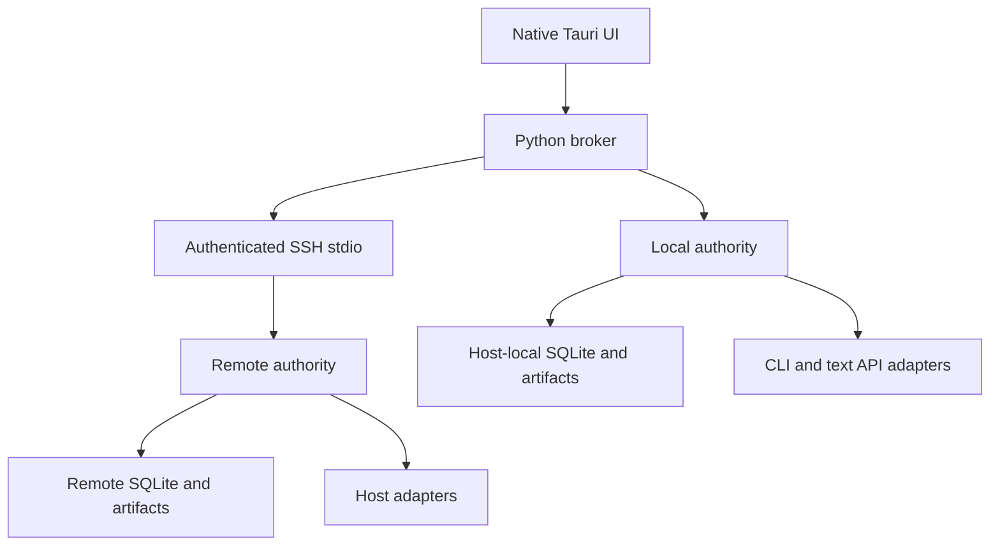

# Architecture decisions — public preview 0.3

## Operating modes

A fresh installation uses a local SQLite authority and executes all three roles on the current host. Demo uses a separate database and simulated agents. An optional SSH environment places authority and execution on a remote Windows, Linux or macOS host. The explicit Windows-first split profile keeps canonical state on Windows and local planning/review on the desktop host.

An environment switch selects another authority; it does not synchronize, migrate or silently reroute existing tasks. Unknown/active outcomes must be reconciled before switching. Only one authority is selected at a time.

## Decisions

| Area | Decision | Reason / boundary |
|---|---|---|
| Desktop | Tauri 2, bundled React/TypeScript | Native window, no hosted execution dashboard |
| Backend | Python, frozen into macOS release | Modular orchestration with no user Python install |
| Persistence | SQLite WAL per authority | Local transactional state; never shared live DB files |
| Task graph | Fixed Plan → Execute → Review | Inspectable initial implementation; dynamic DAG deferred |
| Ordering | Monotonic database sequence plus event IDs | Deterministic per-authority timeline and idempotent ingestion |
| CLI | Codex read-only; Claude tool-free | Bounded initial capabilities |
| API | OpenAI-compatible Chat Completions | Text-only provider integration, not a filesystem agent |
| Secrets | CLI-owned auth; session keys in memory | No secrets in profiles, history or source control |
| Network | SSH stdio, strict host-key checking | No public listener; Tailscale optional private transport |
| Routing | Explicit host labels and selected profile | No fallback from remote to local execution |
| Completion | Output plus explicit human acceptance | Exit 0 and model confidence are not acceptance evidence |
| Recovery | Leases; no blind replay | Unknown process/request outcomes become Blocked |
| Packaging | macOS arm64 `.pkg`, bundled runtime | Local ad-hoc signatures; notarization remains pending |

## Component contracts

- Desktop sends an allowlisted `op` and structured `args` through one Rust IPC command.
- The broker serializes connection changes with scheduler claims. It owns SSH, not the agent sandbox.
- The Store implements task creation, lifecycle controls, claims, pulses, immutable events, artifacts and history cursors.
- CLI adapters receive a step and a bounded prior-handoff context. They emit attributed events and a final text result.
- The text adapter receives the same structured task context, sends a bounded prompt to the explicitly configured endpoint, and returns text. It has no tool-execution loop.
- The remote service reads JSON lines over SSH stdio. Protocol 2 supports `single` and Windows-only `split` layouts. No arbitrary method names or shell prompts are accepted from model output.
- Provider profiles and keys live on the selected execution authority. Keys are never included in snapshots; endpoint edits clear session keys.

## Data model

The executable schema is in `backend/core.py`.

| Table | Purpose |
|---|---|
| tasks | Goal, workspace, criteria, lifecycle and optimistic revision |
| steps | Role, agent, fixed dependency order, immutable host assignment, attempt and lease |
| events | Unique event ID, global authority sequence, task/step/agent/host/session attribution, timestamp, type, status and summaries |
| artifacts | Bounded text handoff, checksum, provenance and creation time |
| commands | Idempotency key and request hash |
| history | Read-only import summary, native session, original file/offset/hash |
| cursors | Incremental source position and identity |

Event UPDATE/DELETE are rejected by SQLite triggers. Ingestion deduplicates IDs and rejects mismatched idempotency payloads. Multi-authority global ordering and complete native transcript version support are future work.

## Lifecycle and recovery

Draft → Queued → Planning/Running → Verifying → Completed. Paused resumes a step from the beginning, not a native-session continuation. Cancel requests wait for worker acknowledgement; stale attempts cannot publish results. Expired leases become Blocked and never auto-retry. Closing the service stops owned CLI processes; external API requests may still finish remotely, but cancelled late results cannot publish artifacts.

Sensitive operations are outside the capabilities of this preview. A future write-enabled adapter must include explicit approval contracts, workspace isolation and independently verifiable acceptance tests before it is enabled.

## Storage

Local tasks are stored under the app cache's `local/` directory, Demo under `demo/`. SSH authority files live under the operator-configured root. Native agent sessions and credentials remain in their original directories. The package runtime is read-only application content, separate from workspaces.

Metadata admission is bounded around 80 MB per Store. The desktop 1 GB managed-cache target is not a whole-process guarantee. No automatic repository mirroring, model downloads, archive replication or large artifact transfer occurs. Active workspaces are user-managed and not deleted. Production retention, backup restore and complete cache accounting remain roadmap requirements.

## Failure matrix

| Failure | Behavior |
|---|---|
| Missing CLI | Step fails with an actionable diagnostic |
| API auth/model error | Sanitized HTTP status; no retry |
| API redirect | Rejected before forwarding credentials |
| API truncation/tool response | Fails the text-response contract |
| Pause/cancel during API request | Late result discarded; billing may still occur |
| SSH loss | Live actions blocked; no local fallback |
| Lease loss or crash | Blocked outcome; reconcile before re-execution |
| Environment change with pending work | Rejected until paused/cancelled/reconciled |
| Metadata limit | New work blocked, no automatic deletion |
| Native transcript format unknown | Partial supported import only; original untouched |

## Verification boundaries

Tests exercise local contracts, a POSIX service subprocess, fake CLI output and mocked provider responses. The release process tests the frozen backend and native build. Real provider authentication, paid calls, GUI interactions, Windows CLI execution and cross-network reconnection need operator validation. They are not implied by tests passing.
