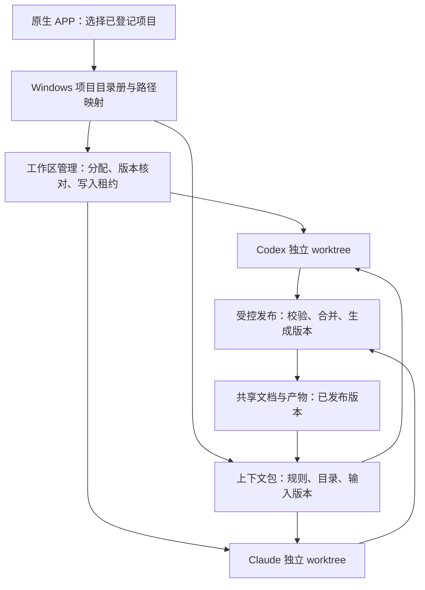

# 项目登记、隔离工作区与跨智能体上下文：核查及建议

状态：设计提案，未实现、未自动附加。核查基线：ACC 0.11.2，提交 bc911da，2026-10-31。
本文件不代表 Windows 已部署任何新服务，也不代表现有工作目录已迁移。

## 1. 最初确实规划过，当前只完成了部分基础

最初项目目录中的 `outputs/Agent-Control-Center-Architecture-Review.md`（位于 prototype 仓库外） 在 ADR 010/011 中指定了每次执行独立 Git worktree、任务绑定的 stdio MCP；数据模型包含 projects、workspace_mappings、资源租约；第 11 节定义版本化上下文包。

本次直接检查发布源码，得到以下结果：

| 能力 | 当前实现 | 证据 |
|---|---|---|
| 用户项目目录 | 每个任务保存 workspace 字符串；UI 按 environment 记住上次路径 | backend/core.py Store.create；src/main.tsx NewTask |
| 项目登记表 | 尚无 projects、project_hosts、workspaces 表 | backend/core.py 初始化 SQL |
| Mac/Windows 映射 | 手填备用路径或取全局 mac_workspace；不核对是否同一仓库/版本 | backend/routing.py Routing.submission |
| 工作树隔离 | 没有自动 git worktree add，也没有路径资源锁 | backend/agents.py run 直接使用 task.workspace；core.py claim 只锁步骤 |
| 上下文 | 启动每个 agent 时自动加入目标、验收标准、角色/权限和前序输出（每份最多 10,000 字符） | backend/agents.py prompt_for |
| 项目存放规则 | 尚未自动附加项目目录清单、规则版本、输入文件 manifest | 同上 |
| handoff | 存在 SQLite artifacts.content；不是自动写到用户指定共享文档目录 | backend/core.py finish |
| Claude 能力 | 当前适配器禁用文件/命令工具及 MCP，仅文字推理 | backend/agents.py argv |
| MCP context server | 未实现，capabilities.mcp=false | backend/bridge.py snapshot |

`AGENTS.md` 已要求并发任务各用 worktree，但这是给开发者的说明，不是应用的自动隔离机制。当前每个执行器基本串行，减少了冲突概率；它不能阻止多个客户端、手动 CLI 或未来并行 worker 写同一个目录。

特别需要修正：**备用目录存在不等于项目身份正确。** 全局 Mac 目录可能属于 ACC，而任务目标属于另一个项目。下一步应要求匹配 project_id、仓库身份和输入版本，不能只检查 is_dir。

## 2. 用户维护的是项目目录册；worktree 由软件分配

用户在原生 APP 的「项目与工作区」中登记：项目名、仓库、主存储主机、各主机路径、共享文档、数据位置、默认输出位置、允许执行主机。创建任务只选项目，界面展示这次实际分配的路径与分支。

- Windows 为目录册、项目源代码、共享资料和产物的主存储位置。
- Mac 只缓存有权限的项目元数据、规则摘要及必要任务文件；不自动拉取所有仓库。
- 同一个项目可有多个 worktree；worktree 是某个任务执行尝试的临时工作副本，不是一个 agent 的永久私有项目。
- 同一任务的规划、执行、审查，通过明确的 commit/artifact 版本交接。
- 同时写代码的 agent 必须各有工作副本。审查使用执行结果的固定提交或只读快照。
- 文件不应按 Codex/Claude 分出两套权威目录；身份不同不改变项目的路径和命名规则。

图中除现有 APP/基本任务存储外，登记、自动 worktree、发布和 MCP 都是拟新增能力。

## 3. 最小数据结构

复用现有 SQLite，先增加以下实体；不是另建一套数据库服务。

| 实体 | 关键字段 | 约束 |
|---|---|---|
| projects | project_id, name, repo_identity, canonical_host_id, policy_revision, policy_hash | ID 稳定；本机路径不作为项目 ID |
| project_hosts | project_id, host_id, repo_path, worktree_root, data_locations, available, verified_commit | 主机分别验证真实路径与仓库；不得靠字符串替换盘符 |
| workspaces | workspace_id, project_id, task_id, attempt_id, host_id, physical_path, base_commit, branch, state, lease_epoch | 同一物理目录只允许一个有效写入租约 |
| context_packages | context_id, revision, task_id, attempt_id, workspace_id, policy_hash, input_manifest, input_hash | 每次启动固定版本；不能只存一个不断覆盖的 latest 文本 |
| resource_versions | project_id, logical_uri, version, content_hash, producer_attempt, state | 文件先 pending、后发布；只有发布成功版本成为下游默认输入 |

逻辑地址例如 `project://acc/docs/design.md`；执行器将它解析为当前项目授权的资源。不要把逻辑 URI 直接当成磁盘路径，也不要允许调用者指定任意绝对路径。

下例只是目录布局示意，**D 盘不是已探测/已批准的目标盘**。实际根目录由用户选择并检查容量、ACL 后登记。

| 内容 | Windows 路径示例 | Mac 行为 |
|---|---|---|
| 主仓库 | `<data-root>/projects/acc/repo` | 按需已有副本；不自动整库复制 |
| 任务工作树 | `<data-root>/worktrees/acc/<task>/<attempt>` | 仅符合离线条件的活动工作树 |
| 共享项目文档 | 仓库 `docs/` 中的已发布版本 | 按固定提交读取或取小文件快照 |
| 大数据集 | `<data-root>/datasets/<dataset>/<version>` | 默认只显示 manifest，Windows-only |
| 任务输出 | `<data-root>/artifacts/<task>/<attempt>` | 小文件缓冲；大文件远端存储 |
| 上下文 | 小型只读 `context.json` 与任务规则摘要 | bounded cache，不含认证信息 |

原生 Codex/Claude sessions 和认证目录保持原位。Git worktree 在每台主机的本地仓库内创建；不能跨主机共享同一个 `.git` 元数据目录。

## 4. 每次启动自动附加什么

**每次新任务、每个角色交接、重试/重启，都应重新绑定并验证上下文。** 不要求用户重复贴规则，也不能仅依赖模型自行判断是否调用某个 Skill。

启动顺序：

1. 解析 project_id，核验 host mapping、repo identity、base commit 和所需数据版本。
2. 分配执行尝试的工作副本、资源租约和受限工具权限；失败则不启动 agent。
3. 从同一权威规则生成小型 Task Context Package，记录 hash、revision、来源。
4. 适配器把必需摘要直接加入启动输入；记录实际 cwd、规则 hash、输入 manifest。
5. 开放的 MCP 客户端同时得到任务限定的动态读取/提交接口；无工具的文本模型收到相同快照内容。
6. 下游只接受经过主机检查和平台发布的交接；不能仅因 agent 说“完成”就切换 latest。

必需字段：project_id、task/step/attempt、host、workspace、base_commit、allowed_read、allowed_write、shared_docs 版本、data manifest、output_root、context_revision、policy_hash、前序有效交接引用。只附加本任务相关内容，建议默认 32 KB 上限；完整文档按需取。

规则变更时，已排队的旧上下文重新生成；正在运行的权限撤销要中止/重新授权，不能仅改 Markdown。agent 的自述“已读”不是安全证明；执行器必须记录实际传入内容和被允许的工具，平台校验真实路径/产物。

## 5. 一套规则，三种入口

| 入口 | 用途 | 是否足以强制执行 |
|---|---|---|
| AGENTS.md / CLAUDE.md | 独立打开 CLI 时获得项目静态规则 | 否；依赖版本/项目发现；只作为指导 |
| Agent Skills | 可复用流程：领取工作区、检查输入、整理输出、提交交接 | 否；Skill 的全文通常按需加载 |
| ACC 自动附加 + MCP | 每次启动必需上下文；运行中查最新授权信息、提交产物 | 注入本身不强制；校验由服务端、worker 和 sandbox 执行 |

建议将共享静态指南以 `AGENTS.md` 为单一来源；已有文件只合并明确 ACC 管理段，不覆盖用户原有规则。Claude 需要兼容入口时用相邻 `CLAUDE.md` 的 `@AGENTS.md` 导入。新版 Claude 文档也支持直接加载 AGENTS.md，但受版本及设置影响；不要假定所有用户默认一致。

Skill 采用 Agent Skills 公共格式，保持一份源内容，发布到各适配器支持的目录（Codex `.agents/skills`；Claude `.claude/skills`），用版本/hash 核对生成副本。不要依赖 Windows 跨目录 symlink，也不要让两个副本独立演化。Skill 不携带绝对主机路径和凭据。

**本提案未安装 Skill，也未修改现有 AGENTS.md、CLAUDE.md 或原生配置。**

MCP 建议复用官方 Python SDK，而非手写协议。先用每个执行主机本地的 stdio bridge，通过已有已认证控制通道访问 Windows 服务；不增加公开无鉴权接口。接口示例：

| 工具 | 返回/动作 | 服务端约束 |
|---|---|---|
| get_task_context | 此次执行已绑定的上下文快照 | 绑定 task/attempt，而非任意传 task_id |
| get_workspace | 允许使用的本机路径、base commit、lease | 不暴露无授权项目的绝对路径 |
| read_project_document | 授权文档的固定版本内容 | project scope、路径穿越/链接检查、大小限制 |
| get_handoff | 依赖步骤已发布的结果 | 版本、hash、状态验证 |
| publish_artifact | 注册暂存文件，主机读取校验后发布 | 只能读当前输出目录；校验 checksum、大小和租约 |
| submit_handoff | 一句话摘要、变更文件、证据引用 | 必须匹配 attempt、context revision，不能自行完成任务 |

MCP 服务器注册不能把所有本地目录暴露给模型。尤其不能用一个通用 filesystem server 的全盘 root 代替 project ACL。当前 Claude 适配器明确关闭了 MCP：接入时应按任务白名单开放指定工具，并做真实调用测试；不能只是写个 SKILL.md 就声称已接入。普通 Chat Completions provider 当前没有工具循环，首期只共享上下文快照。

## 6. 可供未来自动附加的 agent 指南（草案）

以下是待实现后由平台填值并注入的规则，不是已生效的权限：

1. 以本次 Task Context Package 的 project_id、workspace 和输入版本为准；先确认当前目录与分支匹配，任何不匹配报 blocked。
2. 源码变更只写本次分配的工作树。禁止修改其他任务的工作树、主仓库、原生会话或认证目录。
3. 共享文档从指定 commit/artifact 版本读取；需要修改时在自己的工作树提出变更，由平台串行合并发布。
4. 数据集只读且固定版本；不存在、版本不符或需要未授权的大下载时停止，不自行换成其他项目目录。
5. 可复用的小型源码/文档进入仓库指定相对目录；生成结果写指定 output_root。临时文件写本次 scratch。日志由平台收集。
6. 交接只提交一句摘要，以及 base/result commit、改动路径、产物 URI/hash、已执行的检查与未解决问题。不要复制整段原始会话。
7. “最新”由平台发布记录决定，不能按文件名、文件修改时间或某个 agent 的自述覆盖旧版本。
8. 没有权限或 MCP 不可用时报告 blocked；不得扩大授权、切换项目或回退到用户 Home。
9. 在 ACC 外独立打开 CLI 可以遵循静态规则，但未领取有效租约的写入不属于受管理协作；平台不得假装能阻止任意外部程序。

## 7. 并发、离线和清理

- 同一工作树同一时刻只允许一个写入尝试；不同任务/并行修改分配不同工作树。分支冲突进入合并队列，不采用最后写入覆盖。
- `git worktree lock` 用于保护 worktree 管理记录，不是进程互斥锁；写入租约由 ACC 维护，runner 强制匹配 lease epoch。Git 的分支检出约束也不能代替访问控制。
- 重试若之前执行结果不明先 reconcile；新 attempt 从已确认 checkpoint 建立新工作副本，保留失败副本供检查。
- Mac 离线执行必须有同项目的已验证本地副本、缓存规则和所需输入。只能产生本地分支/待发布产物，不能离线更新 Windows 的 shared/latest 或项目目录册。
- 重连后先校验 repo、base commit、规则修订和输入 hashes，再导入候选提交；冲突需明确合并。既有 Windows 任务不复制重跑。
- 清理前确认 worktree 无活动租约、提交/产物已收到、dirty/untracked 文件已处理；使用 Git 原生命令管理 worktree。未同步内容和原生 agent 会话不自动删除。

## 8. 实施顺序与验收

A. 项目目录册与主机映射、启动自动上下文、路径与版本校验。任务从“填路径”变为“选项目”。
B. 自动 worktree 与独占写入租约、发布/合并队列；接上最新版本产物 UI。
C. 两个 CLI 的同一 MCP 接口与共享 Skill；文本 API 保留快照模式。

必须验证：
- ACC 与其他项目登记后，切换项目不能沿用前一个项目的备用目录。
- 两个 agent 并发编辑同一个相对文件，物理工作树不同；互写被拒绝。
- 规划、执行、审查读到匹配的 context revision 和固定输入版本；旧 handoff 不自动充当最新结果。
- Codex 与 Claude 都接收相同语义的目录规则；Claude 真正完成授权 MCP 读取，而不只是初始化成功。
- 路径穿越、Windows 大小写/盘符别名、symlink/junction 越界、过期租约、跨项目资源请求被拒绝。
- Windows 离线时，错误仓库、缺失 commit 或 Windows-only 数据阻止 Mac 启动；已有任务不重放。
- 大数据、归档日志和全部仓库不累积到 Mac；只有小快照和活动任务文件落地。
- agent 在 ACC 外运行与平台内受控执行被明确区分；不能将 Markdown 当文件权限隔离。

## 9. 官方资料与复用选择

- Git worktree： https://git-scm.com/docs/git-worktree
- Codex 项目指令： https://learn.chatgpt.com/docs/agent-configuration/agents-md
- Codex Skills： https://learn.chatgpt.com/docs/build-skills
- Claude 指令、AGENTS.md 与导入兼容： https://code.claude.com/docs/en/memory
- Claude Skills： https://code.claude.com/docs/en/skills
- Agent Skills 公共规范： https://agentskills.io/specification
- Codex MCP： https://developers.openai.com/codex/mcp/
- Claude MCP： https://code.claude.com/docs/en/mcp
- 官方 MCP Python SDK（MIT）： https://github.com/modelcontextprotocol/python-sdk

资料核查日期 2026-10-31。各机器实际安装版本和 ACC 限权启动参数仍需做能力测试；官方支持不等于当前 ACC 已接入。此次没有修改业务逻辑、运行 agent 任务、迁移目录或更改原生存储。
